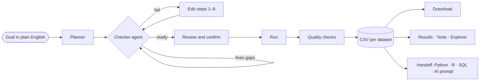
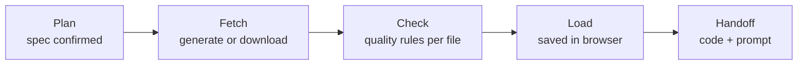
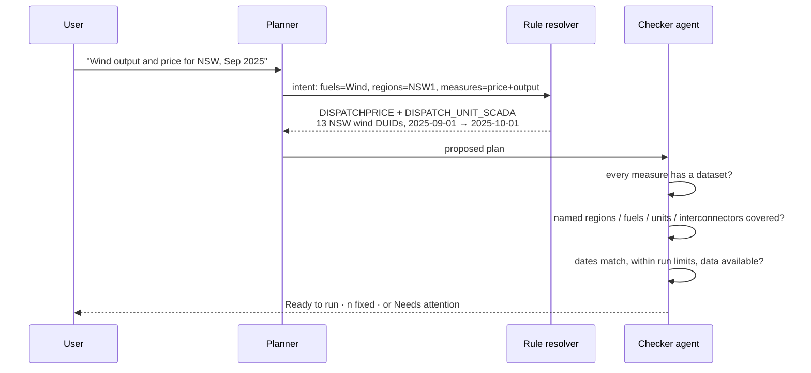
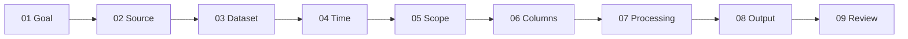
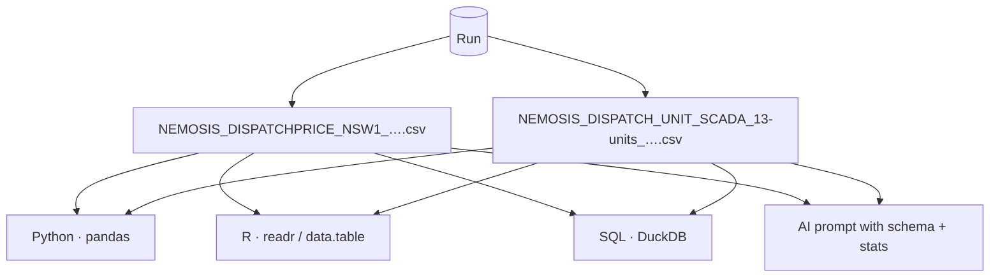
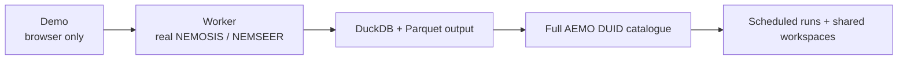

# NEMscope

**Plain-English data runs for the Australian National Electricity Market.**
Describe what you need, NEMscope plans the run, an agent checks it, and you download analysis-ready CSVs with Python, R and SQL code to load them.

**▶ Live demo:** `https://<your-username>.github.io/<repo>/`  ·  Demo version · no sign-in

---

## Contents
- [What it does](#what-it-does)
- [Try it in 2 minutes](#try-it-in-2-minutes)
- [End-to-end flow](#end-to-end-flow)
- [Planner and Checker agent](#planner-and-checker-agent)
- [The 9-step run wizard](#the-9-step-run-wizard)
- [Data sources and datasets](#data-sources-and-datasets)
- [Verified demo cases](#verified-demo-cases)
- [Outputs and handoff](#outputs-and-handoff)
- [Privacy and data handling](#privacy-and-data-handling)
- [Demo limitations](#demo-limitations)
- [Roadmap](#roadmap)

---

## What it does

| | |
|---|---|
| **Ask** | Type a goal such as *"Wind generator output and price for NSW in September 2025"*. |
| **Plan** | The Planner turns it into datasets, regions, units (DUIDs), interconnectors and dates. Categories like "wind generators in NSW" expand to every matching unit. |
| **Check** | The Checker agent tests the plan against your words, fixes gaps and blocks anything that would fail. |
| **Run** | One CSV per dataset, with live progress, quality checks and a log. |
| **Hand off** | Copy-paste Python (pandas), R (readr / data.table) and SQL to load the files, plus an AI prompt. |
| **Explore** | Results view, SQL explorer, data tests and imported CSVs, all in the browser. |

---

## Try it in 2 minutes

1. Open the live demo link above.
2. **New run → Goal** shows 10 verified demo cases. Click **Try it** on any one.
3. Read the **Planner** and **Checker agent** cards. The Checker shows *Ready to run* when every check passes.
4. Click **Review and run → Confirm and run**.
5. When the run finishes, click **Download all CSVs**, then open **Handoff code** for Python, R or SQL.
6. Optional: **Import** your own CSV and open it in **Results**, **Tests** or **Explorer**.

---

## End-to-end flow

### Run stages

---

## Planner and Checker agent

**What the Checker agent tests**

| Check | Action if it fails |
|---|---|
| Every measure in the goal has a dataset | Adds the missing dataset |
| Named regions are in scope | Adds them |
| Units match the goal (fuel × region) | Adds every missing matching unit; warns about unrelated ones |
| Named units / interconnectors included | Adds them |
| Dates match the goal | Resets to the dates in the goal |
| Within run limits | Shortens the range and says so |
| Weather data is available | Moves the window back to available history |
| Run validates | Blocks the run with the reason |

---

## The 9-step run wizard

| Step | What you set |
|---|---|
| 01 Goal | Plain-English request; Planner + Checker fill the rest |
| 02 Source | NEMOSIS, NEMSEER, Weather (any combination) |
| 03 Dataset | One or more tables; each becomes its own CSV |
| 04 Time | Start / end (end exclusive), NEM time UTC+10 |
| 05 Scope | Tabs for Regions, Units (DUIDs) with fuel and region filters, Interconnectors |
| 06 Columns | Value columns per dataset; keys always kept |
| 07 Processing | Native interval, hourly or daily mean; NEM time or UTC |
| 08 Output | CSV file names and tags |
| 09 Review | Errors, notes, run config JSON, equivalent CLI, Confirm and run |

---

## Data sources and datasets

| Source | Dataset | Keyed by | Interval | Max days / run |
|---|---|---|---|---|
| NEMOSIS | `DISPATCHPRICE` | Region | 5 min | 366 |
| NEMOSIS | `DISPATCHREGIONSUM` | Region | 5 min | 366 |
| NEMOSIS | `DISPATCH_UNIT_SCADA` | Unit (DUID) | 5 min | 92 |
| NEMOSIS | `DISPATCHINTERCONNECTORRES` | Interconnector | 5 min | 366 |
| NEMSEER | `P5MIN_REGIONSOLUTION` | Region × run × target | 5 min, 12 targets | 14 |
| Weather | `weather_hourly` | Region (capital city point) | 1 hour | 731 |

Regions: `NSW1` `QLD1` `VIC1` `SA1` `TAS1`. Interconnectors: QNI, Terranora, VNI, Heywood, Murraylink, Basslink.

---

## Verified demo cases

These are checked every time the app loads. A case is **Verified** only when the Planner and Checker produce exactly the expected datasets, regions, units, interconnectors and dates.

| # | Goal | Expected |
|---|---|---|
| 01 | Wind generator output and price for NSW in September 2025 | Price + unit output · all NSW wind units · 2025-09-01 → 2025-10-01 |
| 02 | Solar farms in Queensland, first week of March 2025 | Unit output · all QLD solar units · 2025-03-01 → 2025-03-08 |
| 03 | Heywood and Murraylink flows in Q1 2025 | Interconnector results · V-SA, V-S-MNSP1 · 2025-01-01 → 2025-04-01 |
| 04 | Price vs temperature in Victoria, summer 2025 | Price + weather · VIC1 · 2024-12-01 → 2025-03-01 |
| 05 | P5MIN price forecasts for SA, 1 to 7 September 2025 | P5MIN · SA1 · 2025-09-01 → 2025-09-08 |
| 06 | Demand in all regions for January 2025 | Region summary · all 5 regions · 2025-01-01 → 2025-02-01 |
| 07 | Output of Bayswater and Eraring units in August 2025 | Unit output · BW01, ER01 · 2025-08-01 → 2025-09-01 |
| 08 | QNI flows and NSW and Queensland prices, 2025-02-01 to 2025-02-14 | Price + interconnector · NSW1, QLD1 · NSW1-QLD1 · 2025-02-01 → 2025-02-15 |
| 09 | Brown coal units in Victoria with demand, Q2 2025 | Region summary + unit output · VIC brown coal · 2025-04-01 → 2025-07-01 |
| 10 | Hornsdale wind farm output in May 2025 | Unit output · HDWF1–3 · 2025-05-01 → 2025-06-01 |

The full benchmark (15 cases) is in **Tests → Planner self-test**, with expected vs actual for each field and a downloadable results CSV.

---

## Outputs and handoff

- Columns match NEMOSIS output; timestamps in NEM time (or UTC if chosen).
- **Download CSV** gives the file exactly as generated. **Download cleaned** sorts, de-duplicates and normalises timestamps.

---

## Privacy and data handling

- Runs entirely in the browser. No server, no account.
- Imported CSVs and run outputs are stored in the reviewer's own browser (IndexedDB) and never uploaded.
- AI features, when available, send column names and summary statistics only, never raw rows.

---

## Demo limitations

- NEMOSIS and NEMSEER datasets are **simulated** with the NEMOSIS column layout until the data worker is connected. Weather is **live** from Open-Meteo.
- The unit list is a sample of 58 registered units with approximate capacities. The full AEMO registration list arrives with the worker.
- Output is CSV only in the demo. DuckDB and Parquet arrive with the worker.
- Browser limit: about 1.5 million rows per run.

---

## Roadmap

---

NEMscope · Demo version. Not affiliated with AEMO. Simulated data must not be used for trading or reporting.
